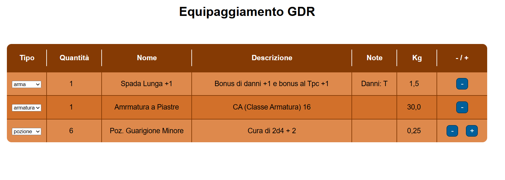

# Equipaggiamento GDR

Pagina web per tenere traccia dell'equipaggiamento di un personaggio
di un gioco di ruolo. Funziona nel browser, senza server né account.

## Funzioni

- Tabella con: tipo, quantità, nome, descrizione, note e peso (Kg)
- Il bottone `+` aggiunge una riga
- Il bottone `-` elimina la riga in cui si trova.
- Salva automaticamente nel browser (`localStorage`)

## Come usarla

Scaricare il progetto e aprire `index.html` nel browser.

## File del progetto

- `index.html`: struttura della pagina
- `style.css`: aspetto della pagina
- `script.js`: creazione delle righe, salvataggio e ripristino

## Personalizzazione

Le categorie del menu "Tipo" sono nell'array `tipi` in `script.js`.

## Limiti

I dati restano nel browser in cui sono stati scritti. Cambiando browser
o dispositivo la tabella risulta vuota.

## Da implementare

- Mostrare il totale del peso sotto la tabella
- Far andare a capo il testo lungo nelle celle".
- Esportare e importare i dati in un file `.json`
- Filtrare o ordinare le righe per tipo o per nome
- Rendere il layout adatto anche a schermi più piccoli
- Gestire più schede (un personaggio per scheda)
- Trasformarla in PWA per usarla come app su desktop e Android